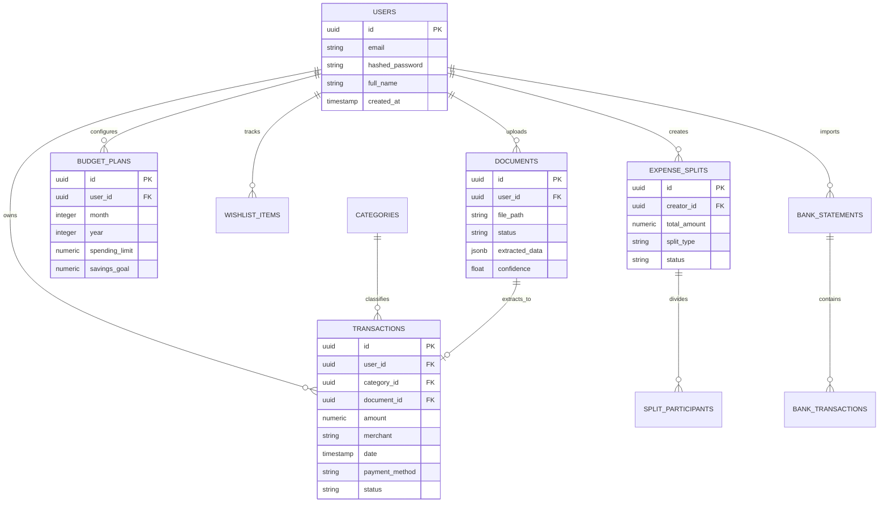

{ .tiet-logo }

**UCS503: Software Engineering (Project)**  
**Department of Computer Science & Engineering**  
**Thapar Institute of Engineering and Technology, Patiala**

---

# Intelligent Expense Tracker

> **An automated platform for document-driven expense capture, collaborative spending, and personal financial intelligence.**

---

## Authors & Team Members

| Roll Number | Name | Email | Student Journal |
| :---: | :--- | :--- | :--- |
| `1024170262` | **Sarwangini Hamal** | `shamal_be24@thapar.edu` | [Sarwangini's Journal](journals/1024170262-sarwangini/index.md) |
| `1024170263` | **Aashi Tyagi** | `atyagi1_be24@thapar.edu` | [Aashi's Journal](journals/1024170263-aashi/index.md) |
| `1024170264` | **Gauransh Arora** | `garora1_be24@thapar.edu` | [Gauransh's Journal](journals/1024170264-gauransh/index.md) |
| `1024170267` | **Divyansh Kumar** | `dkumar1_be24@thapar.edu` | [Divyansh's Journal](journals/1024170267-divyansh/index.md) |

**Faculty Mentor / Submitted to:** Nisha Thakur  
**GitHub Repository:** [Gauransh-Arora/UCS503-202627-Intelligent-Expense-Tracker](https://github.com/Gauransh-Arora/UCS503-202627-Intelligent-Expense-Tracker)  
**Live Documentation:** [Deployed on GitHub Pages](https://gauransh-arora.github.io/UCS503-202627-Intelligent-Expense-Tracker/)

---

## 1. Project Overview & Motivation

The **Intelligent Expense Tracker** bridges the gap between fragmented financial data and actionable personal finance intelligence. In modern everyday life—especially for university students and young professionals in India—financial transaction records originate across highly fragmented channels:
- Instant UPI payment screenshots (Google Pay, PhonePe, Paytm)
- Printed supermarket and retail paper receipts
- Restaurant and cafe invoices (with taxes, line items, and discounts)
- Monthly multi-page bank statements (PDF or delimited CSV exports)

Traditional expense managers fail because manual data entry creates immediate friction, optical character recognition (OCR) tools often commit noisy errors straight into the ledger, and financial math frequently suffers from floating-point rounding errors when splitting group tabs.

### Core Value Proposition
1. **Human-in-the-Loop OCR Draft Verification:** Uploaded documents are preprocessed and parsed into unconfirmed drafts with field-level confidence scores. Users review, edit, and confirm before ledger persistence; discarded drafts leave zero trace in the database.
2. **Exact Decimal Financial Precision:** Eliminates IEEE-754 floating-point drift. All ledger amounts, balances, split calculations, and settlement entries use exact `Numeric(12, 2)` / `Decimal` arithmetic with deterministic penny remainder distribution.
3. **Continuous User-Feedback Categorization:** Keyword rules provide immediate merchant classification, while user overrides update per-user preference weights that take permanent precedence.
4. **Comprehensive Bank Statement Ingestion:** Delimiter and encoding sniffing, Indian banking narration cleaning (UPI, POS, NEFT, IMPS, ACH), mathematical running balance reconciliation, duplicate detection, and one-click ledger merge.
5. **Statistical Intelligence & Purchase Readiness:** Data-driven spending velocity tracking, statistical anomaly alerts ($mean \pm k \cdot \sigma$) with minimum-history guards, and realistic purchase readiness scores for wishlist items.
6. **Conversational Natural Language Interface:** Answers spending inquiries with safe parameterized SQL queries, honestly communicating when data is insufficient.

---

## 2. Supported Use Cases (UC-01 through UC-08)

```
┌─────────────────────────────────────────────────────────────────────────────┐
│                       Intelligent Expense Tracker Engine                    │
├─────────────────────┬───────────────────────────┬───────────────────────────┤
│ Intake & Documents  │ Collaboration & Budgets   │ Analytics & Intelligence  │
├─────────────────────┼───────────────────────────┼───────────────────────────┤
│ UC-01: Document OCR │ UC-04: Group Split & Settle│ UC-05: Feedback Learning  │
│ UC-02: Draft Verify │ UC-06: Budget & Readiness │ UC-07: Statistical Anomaly│
│ UC-03: Manual Entry │ UC-08: Bank Statement     │ UC-07: NL Query Assistant │
└─────────────────────┴───────────────────────────┴───────────────────────────┘
```

### UC-01: Document-Driven Expense Intake
- Supports JPEG, PNG, and PDF document uploads.
- Image preprocessing pipeline using PIL: automatic greyscale conversion, contrast enhancement, noise reduction, and deskewing.
- Multi-engine OCR extraction with structured parsing: extracts transaction amount, merchant name, date, payment method, tax components, and line items.

### UC-02: Review & Verify Extraction (Human-in-the-Loop)
- Generates an unconfirmed draft with field confidences (`amount`, `merchant`, `date`, `taxes`, `items`).
- The user reviews, modifies extracted fields, selects or confirms categories, and verifies line items.
- Confirming persists the transaction and feeds the user's category preference back into the classification engine.
- Discarding invokes `DELETE /documents/{id}`, purging the file from disk and database with zero trace.

### UC-03: Manual Expense Logging
- Comprehensive fallback entry for cash or unreceipted purchases.
- Form includes merchant name, exact amount, date/time, category, payment method (UPI, Card, Cash, NetBanking), and notes.

### UC-04: Multi-Participant Split & Settlement
- Split shared group expenses equally, by custom percentage, or by exact itemized amounts.
- Strict mathematical guarantee: $\sum \text{amount\_owed}_i \equiv \text{total\_amount}$. Deterministic 1-paise / 1-cent rounding distribution ensures zero precision drift.
- Settlement tracking with bilateral balances ("who owes whom") across friends and groups.

### UC-05: Dynamic Categorization & Continuous Feedback
- Layer 1: Rule-based merchant classification (`app/data/merchant_category_rules.json`).
- Layer 2: User category preference learning (`UserCategoryPreference`). Whenever a user manually changes a suggested category during review or update, their preference is saved with high confidence ($0.95$) and overrides global rules on future entries.

### UC-06: Budget & Financial Planning
- Monthly spending limits and savings goals configured via `BudgetPlan`.
- Computes available discretionary budget:
  $$\text{Discretionary Budget} = \text{Monthly Income} - \text{Savings Goal} - \text{Fixed Expenses} - \text{Current Month Spending}$$
- Threshold alerts at 80% and 100% budget consumption.
- Purchase readiness evaluator for wishlist items with standardized verdicts: `Comfortable`, `Possible`, or `Not Recommended Currently`.

### UC-07: Financial Intelligence & Anomaly Detection
- Statistical spending anomaly detection: flags transactions where spending exceeds $mean + k \cdot \sigma$ (or median/MAD) with configurable sensitivity $k$ and minimum transaction count guards.
- Natural Language Query ("Ask Your Expenses"): handles questions such as *"How much did I spend on food this month?"* or *"Top merchants in September"* via safe parameterized queries, providing honest fallback responses when context is unsupported.

### UC-08: Bank Statement Processing
- Universal parser supporting CSV, TSV, and PDF bank statements.
- Delimiter sniffing (`,`, `;`, `\t`, `|`), encoding detection, and column synonym normalization (`Date`, `Narration`, `Withdrawal`, `Deposit`, `Balance`).
- Indian banking narration cleaning (stripping UPI reference numbers, merchant POS terminals, IMPS/NEFT routing strings).
- Running balance reconciliation: verifies $\text{Balance}_{n} = \text{Balance}_{n-1} \pm \text{Amount}_n$.
- In-file and cross-history duplicate transaction detection.
- One-click ledger merge (`POST /bank-statements/{id}/merge`) into main transactions.

---

## 3. System Architecture

```
   ┌─────────────────────────────────────────────────────────────┐
   │                   Flutter Mobile App (Client)               │
   │   - Tactile Off-White & Dark Forest Financial Ledger UI     │
   │   - Tabular figures (JetBrains Mono) & DM Sans typography   │
   │   - Dynamic API_BASE_URL (--dart-define)                    │
   │   - Interactive OCR Draft Review & Bank Statement Merge     │
   └──────────────────────────────┬──────────────────────────────┘
                                  │ REST API (JSON)
                                  ▼
   ┌─────────────────────────────────────────────────────────────┐
   │                    FastAPI Backend Server                   │
   │   - Pydantic v2 Settings (Config & Secrets)                 │
   │   - Strict JWT Authentication & Multi-Tenant Isolation     │
   │   - Decimal Financial Precision & MoneyAmount Arithmetic    │
   │   - Image Preprocessing + OCR Extraction Engine             │
   │   - Statistical Spending Velocity & Anomaly Evaluators      │
   └──────────────────────────────┬──────────────────────────────┘
                                  │ SQLAlchemy 2.0 ORM
                                  ▼
   ┌─────────────────────────────────────────────────────────────┐
   │             Database (PostgreSQL / SQLite)                  │
   │   - Numeric(12, 2) Exact Amount Columns                     │
   │   - Tables: Users, Transactions, Documents, Categories,     │
   │     BankStatements, Splits, WishlistItems, BudgetPlans      │
   └─────────────────────────────────────────────────────────────┘
```

### Technology Stack

| Layer | Component | Technologies |
| :--- | :--- | :--- |
| **Frontend** | Cross-Platform UI | Flutter 3.x, Dart, GoRouter, FL Chart, Tabular Figures |
| **Backend** | REST API Server | FastAPI 0.115+, Python 3.12+, Uvicorn |
| **Database** | ORM & Persistence | SQLAlchemy 2.0, PostgreSQL (Production) / SQLite (Local) |
| **Security** | Auth & Encryption | Passlib (bcrypt), Python-JOSE (JWT) |
| **Document Processing** | Vision & OCR | PIL (Pillow), Tesseract OCR, PDFPlumber |
| **Package Tooling** | Environment & Dependency | uv (Astral), Hatchling, Pydantic v2 |

---

## 4. Database Schema & Data Models

All models enforce strict tenant isolation (`user_id` foreign keys on every resource) and use `Numeric(12, 2)` for zero financial rounding drift.



---

## 5. REST API Reference

The backend exposes an interactive OpenAPI specification at `/docs`. Key endpoints include:

### Authentication & Users
| Method | Endpoint | Description |
| :--- | :--- | :--- |
| `POST` | `/auth/register` | Register new user account; returns access token |
| `POST` | `/auth/login` | Authenticate with email/password; returns JWT |
| `GET` | `/auth/me` | Fetch authenticated user profile |
| `PUT` | `/auth/profile` | Update user settings and preferences |

### Transactions (Ledger)
| Method | Endpoint | Description |
| :--- | :--- | :--- |
| `POST` | `/transactions` | Record new manual expense transaction |
| `GET` | `/transactions` | Filter transactions by date range, category, merchant |
| `GET` | `/transactions/{id}` | Retrieve specific transaction details |
| `PUT` | `/transactions/{id}` | Update transaction; learns category preference |
| `DELETE` | `/transactions/{id}` | Soft-delete transaction from user ledger |

### Documents & OCR Extraction
| Method | Endpoint | Description |
| :--- | :--- | :--- |
| `POST` | `/documents/upload` | Upload receipt/bill image or PDF |
| `POST` | `/documents/{id}/process` | Trigger image preprocessing and OCR extraction |
| `GET` | `/documents/{id}` | Fetch document extraction draft with confidence scores |
| `DELETE` | `/documents/{id}` | Discard draft; removes file from disk and database |

### Splits & Friend Settlements
| Method | Endpoint | Description |
| :--- | :--- | :--- |
| `POST` | `/splits` | Create equal, percentage, or custom group split |
| `GET` | `/splits` | List all active and settled group splits |
| `GET` | `/splits/{id}` | Get breakdown of individual participant shares |
| `POST` | `/splits/settlements` | Record debt settlement between participants |
| `GET` | `/splits/friends` | Retrieve friend ledger balances ("who owes who") |

### Budgets & Wishlist Planning
| Method | Endpoint | Description |
| :--- | :--- | :--- |
| `POST` | `/budgets` | Set monthly spending limit and savings goal |
| `GET` | `/budgets/current` | Retrieve current month budget vs. actual consumption |
| `GET` | `/budgets/discretionary` | Calculate available discretionary budget |
| `POST` | `/wishlist` | Add aspirational item to wishlist |
| `GET` | `/wishlist/{id}/readiness` | Compute purchase readiness score and verdict |

### Bank Statement Ingestion
| Method | Endpoint | Description |
| :--- | :--- | :--- |
| `POST` | `/bank-statements/upload` | Upload PDF or CSV bank statement |
| `GET` | `/bank-statements/{id}` | Fetch parsed rows, duplicate warnings, balance audit |
| `POST` | `/bank-statements/{id}/merge` | Merge verified transactions into ledger |

### Analytics & AI Queries
| Method | Endpoint | Description |
| :--- | :--- | :--- |
| `GET` | `/analytics/summary` | High-level summary with month-over-month trends |
| `GET` | `/analytics/categories` | Spending breakdown aggregated by category |
| `GET` | `/analytics/drilldown` | Hierarchical dimension drilldown |
| `POST` | `/ai/query` | Natural language queries with honest fallback |

---

## 6. Frontend Design System

The mobile application utilizes a tactile, editorial fintech design built for readability and precision:

- **Canvas & Contrast:** Warm off-white canvas (`#FBFBF9`) with pure white card surfaces (`#FFFFFF`) and hairline neutral borders (`#E5E7EB`, 1px).
- **Typography:** DM Sans for geometric, accessible body copy, paired with **JetBrains Mono** with tabular figures (`FontFeature.tabularFigures()`) for rupee numbers (`₹1,23,456.50`).
- **Semantic Accents:** Restrained Crimson (`#991B1B`) for expenses, Forest Green (`#166534`) for income/credits, and Muted Teal (`#0F766E`) for interactive focus and brand touchpoints.
- **Microcopy:** Factual, crisp, and free of patronizing chatbot tropes or fake celebratory animations.

---

## 7. Installation & Quickstart Guide

### Prerequisites
- Python 3.12+
- `uv` (recommended Astral Python package manager)
- Flutter SDK 3.x+ with Dart
- Tesseract OCR (optional system library)

---

### Backend Setup (`code/backend`)

```bash
# 1. Navigate to backend directory
cd code/backend

# 2. Configure environment
cp .env.example .env

# 3. Synchronize virtual environment with uv
uv sync

# 4. Initialize database schema & seed initial categories
uv run python migrate.py
uv run python seed_mock.py

# 5. Generate synthetic test fixtures (optional)
uv run python tests/generate_fixtures.py

# 6. Launch the FastAPI backend server
uv run uvicorn app.main:app --reload --host 0.0.0.0 --port 8000
```

The interactive Swagger UI is available at `http://localhost:8000/docs`.

---

### Frontend Setup (`code/frontend`)

```bash
# 1. Navigate to frontend directory
cd code/frontend

# 2. Install Flutter packages
flutter pub get

# 3. Launch application targeting desired platform
# Web / Chrome:
flutter run -d chrome --dart-define=API_BASE_URL=http://localhost:8000

# Android Emulator / Device:
flutter run -d android --dart-define=API_BASE_URL=http://10.0.2.2:8000

# Linux Desktop:
flutter run -d linux --dart-define=API_BASE_URL=http://localhost:8000
```

---

## 8. Verification & Automated Testing

The codebase includes an extensive automated test suite covering all critical computational and security requirements:

### Backend Test Suites (42 Automated Tests)

```bash
cd code/backend
uv run pytest -v
```

1. **Unit Normalization & Decimal Precision (`test_unit_normalization.py`):**
   - Verifies exact `Decimal` arithmetic across all currency operations.
   - Tests bank narration cleaning against hundreds of real-world Indian UPI/POS patterns.
   - Tests date normalization across varied international and Indian formats.
2. **Integration API & Multi-User Isolation (`test_integration_api.py`):**
   - Tests authentication lifecycle, token validation, and password security.
   - Enforces cross-user isolation: user A cannot query, update, or view documents belonging to user B.
   - Verifies budget limit alerts and category preference learning feedback loops.
3. **Pipeline Robustness & Bank Statements (`test_pipeline_and_robustness.py`):**
   - Tests CSV/TSV delimiter sniffing and messy column synonym mapping.
   - Validates mathematical running balance checks and in-file duplicate flagging.
   - Confirms one-click bank statement merge idempotency.
4. **Splits & Friends Settlement (`test_splits_and_friends.py`):**
   - Tests exact penny remainder assignment for odd-numbered splits.
   - Validates bilateral friend settlement ledger calculations.

### Frontend Widget & Unit Tests

```bash
cd code/frontend
flutter test
```

- Validates responsive viewport layouts and navigation paths.
- Verifies OCR draft review screen state handling and discard actions.
- Tests bank statement review screens and merge controls.

---

## 9. Project Deliverables & Navigation

- **Source Code Repository:** [Gauransh-Arora/UCS503-202627-Intelligent-Expense-Tracker](https://github.com/Gauransh-Arora/UCS503-202627-Intelligent-Expense-Tracker)
- **Deployed GitHub Pages Site:** [Project Documentation](https://gauransh-arora.github.io/UCS503-202627-Intelligent-Expense-Tracker/)
- **Individual Student Journals:**
  - [Sarwangini Hamal — `1024170262`](journals/1024170262-sarwangini/index.md)
  - [Aashi Tyagi — `1024170263`](journals/1024170263-aashi/index.md)
  - [Gauransh Arora — `1024170264`](journals/1024170264-gauransh/index.md)
  - [Divyansh Kumar — `1024170267`](journals/1024170267-divyansh/index.md)
- **Academic LaTeX Reports:**
  - Project Proposal: [`project-proposal/main.tex`](https://github.com/Gauransh-Arora/UCS503-202627-Intelligent-Expense-Tracker/tree/main/project-proposal)
  - Prototype Stage Report: [`project-report-prototype-stage/`](https://github.com/Gauransh-Arora/UCS503-202627-Intelligent-Expense-Tracker/tree/main/project-report-prototype-stage)
  - Final Stage Report: [`project-report-final/`](https://github.com/Gauransh-Arora/UCS503-202627-Intelligent-Expense-Tracker/tree/main/project-report-final)
