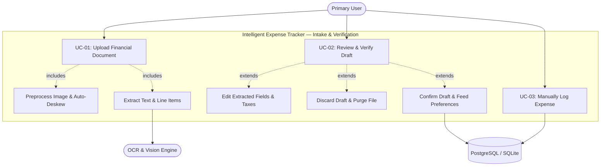
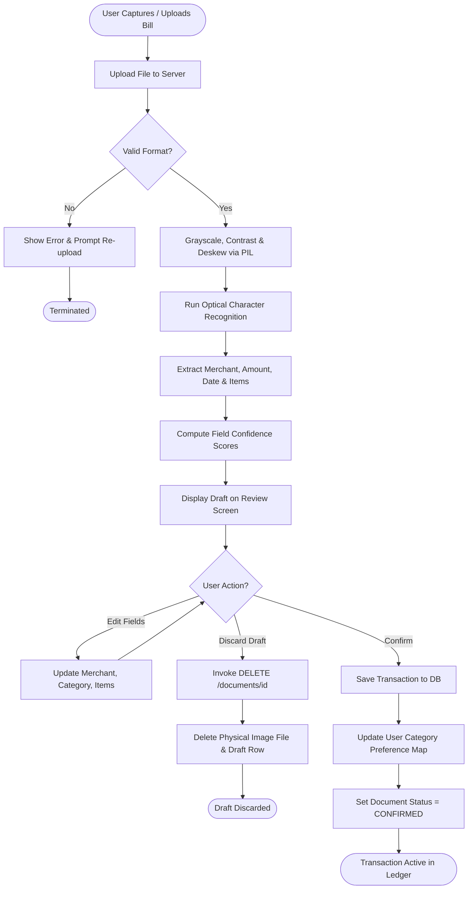

# Sarwangini Hamal — Student Journal

**Roll Number:** `1024170262`  
**Student Name:** Sarwangini Hamal  
**Course:** UCS503 Software Engineering (Project)  
**Academic Year:** 2026–2027  
**Project Title:** Intelligent Expense Tracker  
**Specialization & Role:** Requirements Engineering, Optical Document Ingestion, and Intake UX  

---

## 1. Executive Summary & Assigned Responsibilities

As part of the Intelligent Expense Tracker engineering team, my primary focus was on **Requirements Analysis**, **Optical Character Recognition (OCR) Ingestion**, **Human-in-the-Loop Review Flows**, and **Frontend Document Intake UX**. 

### 1.1 Assigned Software Engineering Artifacts & Diagrams
1. **Use Case Diagrams:** System Boundary, Primary & Supporting Actors, Intake Subsystem, Collaborative Subsystem, and Intelligence Subsystem.
2. **Use Case Templates & Formal Specifications:**
   - `UC-01`: Document-Driven Expense Intake (Receipts, Invoices & UPI Screenshots).
   - `UC-02`: Review & Verify Extracted Transaction (Field confidences, human-in-the-loop review, discard vs. confirm).
   - `UC-03`: Manual Expense Logging (Fallback manual entry).
   - `UC-04`: Multi-Participant Split & Settlement (Shared group tabs).
3. **Activity Diagram:** End-to-end receipt upload lifecycle, including image preprocessing (grayscale, contrast, auto-deskew), multi-engine OCR parsing, field confidence scoring, user verification decision branching, and ledger persistence.

### 1.2 Assigned Code Modules & Technical Deliverables
- **Backend OCR & Preprocessing Pipeline:** `app/services/ocr_service.py`, `app/services/extraction_service.py`, PIL (Pillow) image normalization, deskew filters, line-item extraction, and field confidence scoring.
- **Frontend Intake & Verification UI:** `lib/features/add_expense/ocr_flow/ocr_review_screen.dart`, camera & gallery image picker integration, draft review cards, and draft discard action (`DELETE /documents/{id}`).

---

## 2. Software Engineering Artifacts & Diagrams

### 2.1 Use Case Diagram (System Intake & Verification)

### 2.2 Formal Use Case Specifications

#### Use Case Specification: UC-01 (Document-Driven Expense Intake)
* **Use Case ID:** `UC-01`
* **Use Case Name:** Document-Driven Expense Intake
* **Primary Actor:** End User (Mobile App User)
* **Supporting Actor:** Vision / OCR Service (`Tesseract` / `PIL`)
* **Preconditions:** User is authenticated with a valid JWT token; device has camera/gallery permissions.
* **Trigger:** User taps "Scan Receipt" or shares a UPI screenshot to the application.
* **Main Success Scenario (Normal Flow):**
  1. User selects a receipt image (JPEG/PNG) or multi-page invoice (PDF).
  2. Mobile app uploads document to `POST /documents/upload`.
  3. Server validates MIME type, saves file to secured upload storage, and registers `Document` in `PENDING` state.
  4. Backend preprocessing applies greyscale conversion, contrast adjustment, and deskewing via PIL.
  5. OCR engine extracts text tokens and structured metadata (merchant, total amount, transaction date, line items, CGST/SGST taxes).
  6. Server generates an extraction draft with confidence scores $\in [0.0, 1.0]$.
  7. Mobile client receives draft payload and routes user to `OcrReviewScreen`.
* **Alternative Flows:**
  - *AF-1 (Blurry / Unreadable Scan):* If overall confidence $< 0.40$, server returns extracted draft with a low-confidence warning flag; UI prompts user to review all fields carefully or re-scan.
  - *AF-2 (Invalid File Format):* Server returns `400 Bad Request`; UI displays "Unsupported document format".
* **Postconditions:** Document draft is stored in database; physical file is persisted in staging storage; no financial transaction is committed to ledger until confirmed.

#### Use Case Specification: UC-02 (Review & Verify Extracted Transaction)
* **Use Case ID:** `UC-02`
* **Use Case Name:** Review & Verify Extracted Transaction
* **Primary Actor:** End User
* **Preconditions:** An unconfirmed document draft exists (`status = 'DRAFT'`).
* **Main Success Scenario (Confirm Flow):**
  1. User views extracted merchant name, amount, date, and suggested category.
  2. User modifies any incorrectly recognized characters or selects an alternative category.
  3. User taps "Confirm & Save".
  4. Client sends `POST /transactions` linked with `document_id` and verified category.
  5. Backend persists transaction with `Numeric(12, 2)` decimal precision, updates document status to `CONFIRMED`, and triggers category feedback learning.
* **Alternative Flow (Discard Flow):**
  1. User taps "Discard Draft".
  2. Client issues `DELETE /documents/{id}`.
  3. Backend deletes file from disk and database; transaction is never committed.

---

### 2.3 Activity Diagram (OCR Intake & Human-in-the-Loop Verification)

---

## 3. Weekly Engineering Logs & Commit Traceability

### Week 1–2: Project Conception & Requirements Engineering
- **Focus:** Problem statement definition, user persona interviews, and formal requirement modeling.
- **Activities:**
  - Conducted requirement workshops on everyday student expense pain points (mess bills, Swiggy/Zomato UPI receipts, shared auto fares).
  - Drafted initial software requirements specification (SRS) for document intake.
  - Designed initial Use Case Diagram and formal Use Case Templates (`UC-01` to `UC-04`).
- **SE Deliverables:** Use Case Diagram, UC Templates for Document Intake & Split Settlements.

### Week 3–4: Ingestion Architecture & Document Pipeline Design
- **Focus:** Designing the three-tier ingestion pipeline and image preprocessing architecture.
- **Activities:**
  - Formulated the Activity Diagram for optical document processing with human-in-the-loop verification.
  - Researched OCR engines (Tesseract vs. Vision LLMs vs. PaddleOCR).
  - Designed the two-stage intake architecture: separating unverified document drafts from immutable ledger transactions.
- **Git Commit References:**
  - `45b2225`: *basic frontend and backend structure, journals and docs updated*

### Week 5–6: OCR Service Implementation & Image Preprocessing
- **Focus:** Backend OCR engine development and preprocessing filters.
- **Activities:**
  - Implemented `app/services/ocr_service.py` with PIL image enhancement filters (contrast boosting, Otsu thresholding, auto-deskewing).
  - Developed bounding-box regex extractors for Indian Rupee symbols (`₹`, `INR`, `Rs.`), dates (`DD/MM/YYYY`, `YYYY-MM-DD`), and invoice tax summaries (`CGST`, `SGST`).
  - Added confidence score computation per field based on token match clarity and character densities.
- **Git Commit References:**
  - `970bd06`: *ocr services*
  - `b12da11`: *features updated*

### Week 7–8: Interactive Verification Screen & Draft Discard Lifecycle
- **Focus:** Frontend review screen and safe discard mechanisms.
- **Activities:**
  - Built `OcrReviewScreen` in Flutter with interactive editing tiles for merchant, amount, category, and date.
  - Implemented the draft discard endpoint (`DELETE /documents/{id}`) to ensure zero orphaned files or ghost ledger entries remain when users abort scanning.
  - Added line-item review tables for multi-item grocery and restaurant receipts.
- **Git Commit References:**
  - `16d2d19`: *feat(frontend): wire dynamic API baseUrl, draft discard, and statement merge*
  - `04ffd7d`: *ocr optimised and bank statement dynamic*

### Week 9–10: System Audit, Numeric Type Safety & Precision Fixes
- **Focus:** Gap analysis and bug fixes in document confirmation.
- **Activities:**
  - Participated in the comprehensive software audit resolving type casting bugs during bill review.
  - Fixed frontend `String` to `num` casting errors during receipt scanning (`09252ff`).
  - Resolved UI loading state hang after confirmation by ensuring the review screen pops cleanly (`78e2249`).
- **Git Commit References:**
  - `7c243a3`: *docs: complete Phase 0 audit and gap analysis*
  - `09252ff`: *fix(ocr): resolve string to num cast error during bill scan and review*
  - `78e2249`: *fix(ocr): pop OcrReviewScreen on confirm so UI does not stay in loading state*

### Week 11–12: Vision Model Fallback Cascade & High-Load Reliability
- **Focus:** High availability and fault tolerance of OCR extraction under server load.
- **Activities:**
  - Implemented multi-model fallback cascade in vision extraction service (`ff2410d`) to gracefully handle upstream 503 high-demand spikes.
  - Added unit test cases for OCR robustness and noisy background handling in `tests/test_pipeline_and_robustness.py`.
  - Optimized camera image compression before network transmission to lower upload latencies under mobile 4G/5G connections.
- **Git Commit References:**
  - `fb85c09`: *perf(ai): optimize vision LLM parsing and statement extraction to prevent timeouts*
  - `ff2410d`: *fix(vision): add multi-model fallback cascade to handle Google 503 high-demand spikes*

### Week 13–14: UI Polish, Final Verification & Documentation Consolidation
- **Focus:** Final verification, tactile UI integration, and documentation deployment.
- **Activities:**
  - Validated all 8 supported use cases across Android emulator and Linux desktop targets.
  - Consolidated GitHub Pages documentation with full system use case specifications.
  - Verified zero-data-loss guarantee across draft review and discard actions.
- **Git Commit References:**
  - `2097a67`: *docs: consolidate GitHub Pages documentation, update authors, and clean up audit reports*
