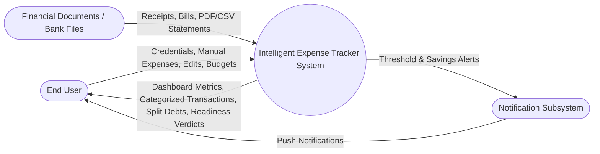
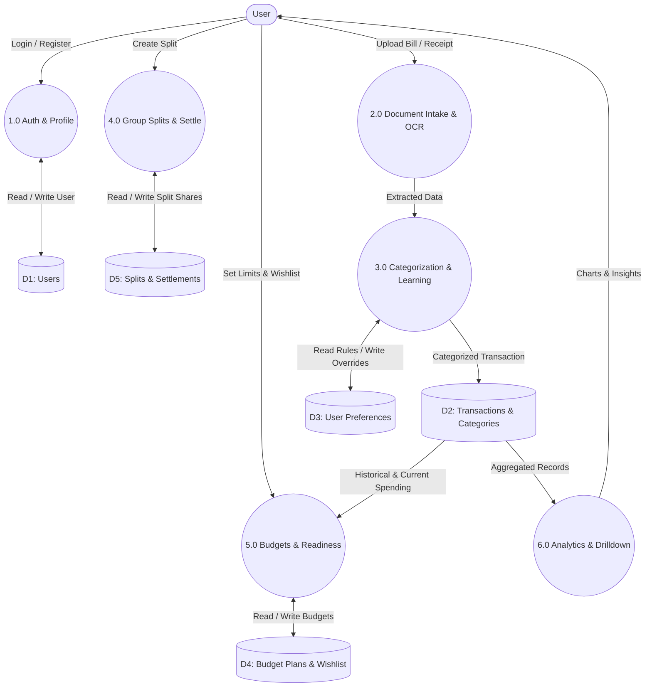
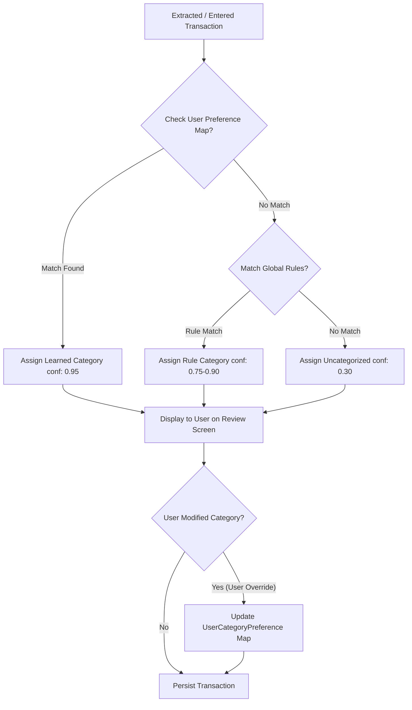
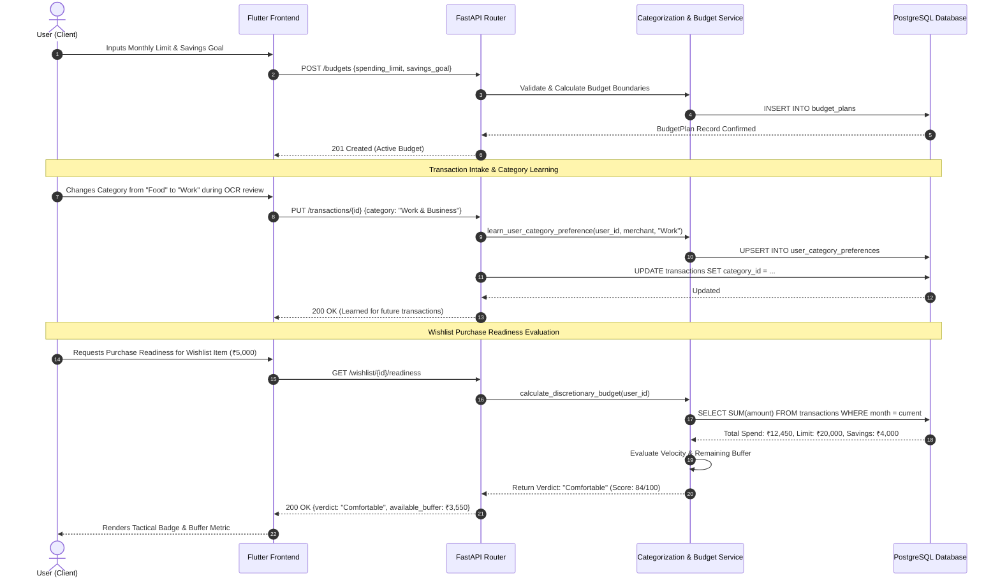

# Aashi Tyagi — Student Journal

**Roll Number:** `1024170263`  
**Student Name:** Aashi Tyagi  
**Course:** UCS503 Software Engineering (Project)  
**Academic Year:** 2026–2027  
**Project Title:** Intelligent Expense Tracker  
**Specialization & Role:** Information Architecture, Data Flow Modeling, Dynamic Categorization & Financial Planning  

---

## 1. Executive Summary & Assigned Responsibilities

Within the engineering team, my core focus was on **Data Flow Modeling**, **Categorization & Preference Learning**, and **Budget & Financial Planning Intelligence**.

### 1.1 Assigned Software Engineering Artifacts & Diagrams
1. **Data Flow Diagrams (DFDs):**
   - **DFD Level 0 (Context Diagram):** High-level data exchanges between External Entities (User, Financial Documents, OCR Engine, Notification Service) and the Expense Tracker System.
   - **DFD Level 1 (Functional Decomposition):** Detailed flow between core processes (1.0 Authentication, 2.0 Ingestion, 3.0 Categorization & Learning, 4.0 Group Splits, 5.0 Budgets & Planning, 6.0 Analytics).
   - **DFD Level 2 (Process Decomposition):** Focused decomposition of **Process 3.0 (Categorization & Preference Learning)** and **Process 5.0 (Budgeting & Purchase Readiness)**.
2. **Swimlane Diagram (Cross-Functional Flowchart):** Operational responsibility mapping across the User (Mobile Client), Frontend View Layer, API Gateway (FastAPI), Intelligence & Categorization Service, and Persistence Layer.
3. **Use Case Templates & Formal Specifications:**
   - `UC-05`: Dynamic Categorization & Continuous User Feedback Learning.
   - `UC-06`: Budget & Financial Planning (Spending limits, savings goals, discretionary budget computation, and wishlist readiness scoring).

### 1.2 Assigned Code Modules & Technical Deliverables
- **Categorization & Learning Engine:** `app/services/categorization_service.py`, `app/data/merchant_category_rules.json`, user preference learning (`UserCategoryPreference`), and override precedence algorithms.
- **Budgeting & Wishlist Intelligence:** `app/models/budget_plan.py`, `app/routers/budgets.py`, `app/routers/wishlist.py`, `app/services/intelligence_service.py` (discretionary budget calculations, purchase readiness scoring, and standardized verdicts).
- **Mobile Budgets & Analytics UI:** `lib/features/budgets/`, `lib/features/analytics/`, FL Chart visualizations, category distribution graphs, and savings push notification schedules (`a485bf8`).

---

## 2. Software Engineering Artifacts & Diagrams

### 2.1 Data Flow Diagrams (DFD)

#### DFD Level 0: Context Diagram

#### DFD Level 1: Functional Decomposition

#### DFD Level 2: Process 3.0 (Categorization & Preference Learning)

---

### 2.2 Swimlane Diagram (Cross-Functional System Flow)

---

### 2.3 Formal Use Case Specifications

#### Use Case Specification: UC-05 (Dynamic Categorization & Feedback Learning)
* **Use Case ID:** `UC-05`
* **Use Case Name:** Dynamic Categorization & Continuous User Feedback
* **Primary Actor:** End User
* **System Component:** Categorization Engine (`app/services/categorization_service.py`)
* **Preconditions:** Transaction merchant string extracted or provided.
* **Main Success Scenario:**
  1. System checks `UserCategoryPreference` for exact or normalized merchant match for `current_user.id`.
  2. If match exists, assigned category is selected with confidence $0.95$.
  3. If no match, merchant is matched against global keyword rules in `merchant_category_rules.json` (e.g., "Swiggy" $\rightarrow$ "Food", "Uber" $\rightarrow$ "Transportation").
  4. Extracted category is presented to user on transaction screen.
  5. If user overrides category, a new preference weight is written to the database, ensuring that all future transactions from that merchant immediately resolve to the user's preferred category.
* **Postconditions:** Preference mapping updated; transaction linked to resolved category.

#### Use Case Specification: UC-06 (Budget & Purchase Readiness)
* **Use Case ID:** `UC-06`
* **Use Case Name:** Budget Planning & Wishlist Purchase Readiness
* **Primary Actor:** End User
* **Main Success Scenario:**
  1. User navigates to Budgets and configures spending limit and savings target for the active month.
  2. System aggregates all confirmed debit transactions for the month.
  3. Available discretionary budget is calculated:
     $$\text{Discretionary} = \text{Income} - \text{Savings Target} - \text{Fixed Recurring Expenses} - \text{Month Spend}$$
  4. For wishlist items, system runs purchase readiness algorithm factoring item price, remaining discretionary room, and spending velocity.
  5. System returns canonical verdict (`Comfortable`, `Possible`, or `Not Recommended Currently`) with progress indicators.
* **Alternative Flows:**
  - *AF-1 (Overspend Alert):* When monthly spending exceeds 80% or 100% of the limit, system displays prominent alert cards.

---

## 3. Weekly Engineering Logs & Commit Traceability

### Week 1–2: Requirements Analysis & Data Flow Design
- **Focus:** System information architecture and initial data flow decomposition.
- **Activities:**
  - Created DFD Level 0 (Context Diagram) and DFD Level 1 (Functional Architecture).
  - Drafted formal Use Case Templates for `UC-05` (Categorization) and `UC-06` (Budget Planning).
  - Defined initial schema requirements for `Category`, `UserCategoryPreference`, and `BudgetPlan`.

### Week 3–4: Core Service Skeleton & Merchant Rules Mapping
- **Focus:** Initial categorization rules and data stores.
- **Activities:**
  - Built initial keyword dictionary for common Indian merchants (Zomato, Swiggy, Blinkit, Zepto, Uber, Ola, IRCTC).
  - Constructed the DFD Level 2 diagram for the continuous learning feedback cycle.
  - Formulated the cross-functional Swimlane Diagram tracing transactions from client input to database commit.
- **Git Commit References:**
  - `45b2225`: *basic frontend and backend structure, journals and docs updated*

### Week 5–6: Dynamic Categorization Engine Implementation
- **Focus:** User preference learning and rule-precedence algorithms.
- **Activities:**
  - Developed `app/services/categorization_service.py` with hierarchical resolution: User Override Preference $\rightarrow$ Global Keyword Rule $\rightarrow$ Default Uncategorized.
  - Implemented `learn_user_category_preference()` function triggered on transaction creation and updates.
  - Created `app/data/merchant_category_rules.json` to eliminate hardcoded Python dictionary strings.
- **Git Commit References:**
  - `b12da11`: *features updated*
  - `e8cf25e`: *feat(backend): implement dynamic rules, exact decimal precision, and budget planning*

### Week 7–8: Budget Planning & Purchase Readiness Intelligence
- **Focus:** Discretionary budget math and wishlist readiness scoring.
- **Activities:**
  - Implemented `app/models/budget_plan.py` with `spending_limit` and `savings_goal` columns using `Numeric(12, 2)`.
  - Built `calculate_discretionary_budget()` in `app/services/intelligence_service.py`.
  - Implemented `generate_purchase_verdict()` evaluating wishlist items with standardized title-case verdicts (`Comfortable`, `Possible`, `Not Recommended Currently`).
- **Git Commit References:**
  - `e8cf25e`: *feat(backend): implement dynamic rules, exact decimal precision, and budget planning*
  - `16d2d19`: *feat(frontend): wire dynamic API baseUrl, draft discard, and statement merge*

### Week 9–10: Software Engineering Audit & Bug Fixes
- **Focus:** Resolving categorization and dropdown UI bugs.
- **Activities:**
  - Fixed categorization defect where newly imported transactions displayed as "Uncategorized" due to lazy category relationship loading (`52c6ab9`).
  - Guarded frontend category dropdowns against null or duplicate category items (`59bdbb8`).
  - Added unit test cases in `tests/test_unit_normalization.py` verifying that user category overrides take strict precedence over global keyword rules.
- **Git Commit References:**
  - `7c243a3`: *docs: complete Phase 0 audit and gap analysis*
  - `52c6ab9`: *fix(categories): ensure transactions always carry resolved category and prevent uncategorized display*
  - `59bdbb8`: *fix(frontend): guard dropdown values against missing or duplicate category items*

### Week 11–12: Push Notification Schedules & Mobile Performance
- **Focus:** Mid-month savings reminders and mobile analytics navigation.
- **Activities:**
  - Implemented mid-month and 25th-of-the-month savings push notification triggers on app launch (`a485bf8`).
  - Optimized analytics month-to-month navigation in Flutter to prevent unnecessary rebuilds (`c29ff00`).
  - Resolved zero-amount bug in recurring subscriptions detector (`b3f983d`).
- **Git Commit References:**
  - `a485bf8`: *feat(wishlist): add mid-month and 25th savings push notifications and auto-trigger on app launch*
  - `c29ff00`: *feat(mobile): optimize mobile performance and implement analytics month navigation*
  - `b3f983d`: *fix(recurring): fix zero amount bug and missing metadata in recurring bills*

### Week 13–14: Final Integration & Documentation Consolidation
- **Focus:** Verification of analytics dashboards, budget thresholds, and docs.
- **Activities:**
  - Conducted end-to-end testing of 80% and 100% budget threshold alerts.
  - Verified FL Chart visual rendering on web and mobile targets.
  - Contributed to GitHub Pages documentation deployment and user manual updates.
- **Git Commit References:**
  - `2097a67`: *docs: consolidate GitHub Pages documentation, update authors, and clean up audit reports*
