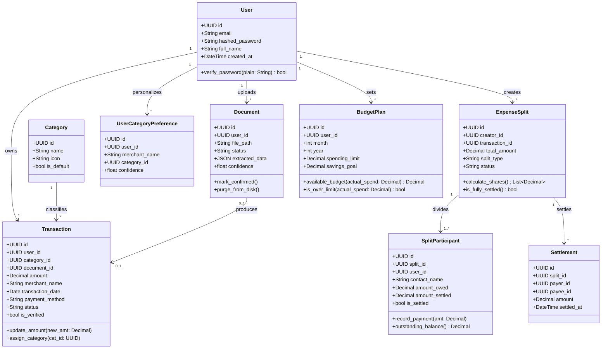
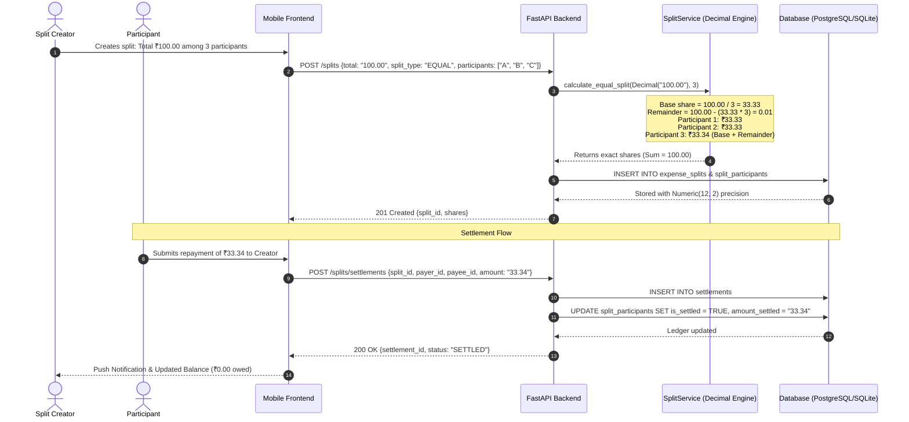

# Gauransh Arora — Student Journal

**Roll Number:** `1024170264`  
**Student Name:** Gauransh Arora  
**Course:** UCS503 Software Engineering (Project)  
**Academic Year:** 2026–2027  
**Project Title:** Intelligent Expense Tracker  
**Specialization & Role:** System Architecture, Domain Modeling, Financial Precision & Group Splitting Engine  

---

## 1. Executive Summary & Assigned Responsibilities

As lead architect on the project, my responsibilities spanned **System Architecture Design**, **UML Domain Modeling**, **Exact Financial Precision & Arithmetic**, and the **Collaborative Group Splitting Subsystem**.

### 1.1 Assigned Software Engineering Artifacts & Diagrams
1. **Class Diagram (Domain Model):** Complete UML Class Diagram detailing all core domain entities (`User`, `Transaction`, `Document`, `Category`, `UserCategoryPreference`, `ExpenseSplit`, `SplitParticipant`, `Settlement`, `BudgetPlan`, `BankStatement`, and `BankTransaction`) with explicit attributes, methods, access visibilities, multiplicities, and relationships.
2. **Sequence Diagram (Group Split & Debt Settlement):** Chronological message-passing sequence for creating group splits (`POST /splits`), executing exact decimal division, resolving indivisible 1-paise remainders, updating friend balances, and recording bilateral settlements.
3. **Deployment Diagram:** Hardware and software deployment node topology: Client Tier (Flutter on Android/iOS/Web), Application Server Tier (FastAPI/Uvicorn on Render/Local), Persistence Tier (PostgreSQL on Supabase / SQLite local), and external OCR engines over HTTPS.

### 1.2 Assigned Code Modules & Technical Deliverables
- **System Architecture & Core Settings:** `app/database.py`, `app/config.py` (Pydantic `BaseSettings`), database migrations (`migrate.py`), database seeding (`seed_mock.py`), and tenant isolation filters.
- **Financial Splitting & Settlement Engine:** `app/services/split_service.py`, `app/models/split.py`, exact decimal arithmetic (`Decimal` / `Numeric(12, 2)`), equal/percentage/custom split calculators, deterministic penny remainder assignment, and friend ledger balances (`/splits/friends`).
- **Frontend Architecture & Tactile UI Redesign:** `lib/core/network/api_service.dart` (`--dart-define=API_BASE_URL`), state synchronization listeners (`c5b295e`), tactile fintech UI design system (`app_colors.dart`, tabular figures via `FontFeature.tabularFigures()`), and DiceBear avatar integration (`a4eba21`).

---

## 2. Software Engineering Artifacts & Diagrams

### 2.1 UML Class Diagram (Domain Model)



---

### 2.2 Sequence Diagram: Multi-Participant Split & Settlement



---

### 2.3 UML Deployment Diagram

```mermaid
graph TD
    subgraph ClientDevice [Client Tier: User Device]
        MobileApp[Flutter Client App<br/>Android / iOS / Web<br/>• Tabular Figures (JetBrains Mono)<br/>• Local Secure Storage]
    end

    subgraph ServerNode [Application Server Tier: Cloud / Local Host]
        FastAPIApp[FastAPI REST Server<br/>• Uvicorn ASGI Runner (Python 3.12)<br/>• Pydantic v2 Settings & Auth<br/>• Decimal Money Arithmetic Engine]
        Alembic[Alembic Database Migrator]
    end

    subgraph DataNode [Persistence Tier: Managed Database]
        PostgresDB[(PostgreSQL / SQLite Database<br/>• Tables with Numeric(12, 2) Columns<br/>• Strict Foreign Key Isolation)]
    end

    subgraph VisionService [External Vision Tier]
        OCRWorker[Tesseract Engine / Vision Fallback API]
    end

    MobileApp -- HTTPS / REST (JSON) -- Port 443/8000 --> FastAPIApp
    FastAPIApp -- SQLAlchemy 2.0 ORM (psycopg2) --> PostgresDB
    Alembic -- DDL Migrations --> PostgresDB
    FastAPIApp -- Asynchronous HTTPS Requests --> OCRWorker
```

---

## 3. Weekly Engineering Logs & Commit Traceability

### Week 1–2: Project Baseline & Architectural Strategy
- **Focus:** System architecture specification, repository structure, and LaTeX proposal.
- **Activities:**
  - Initialized repository structure with `code/backend` (FastAPI) and `code/frontend` (Flutter).
  - Drafted UML Class Diagram and Deployment Diagram for project proposal.
  - Formulated the exact financial precision standard: banned IEEE-754 floats from database schemas and calculation services.
- **Git Commit References:**
  - `b82c48d`: *initial commit*
  - `06f2e56`: *Update initial working copy.*
  - `20ace1c`: *added proposal*

### Week 3–4: Core Database Architecture & Backend Gateway
- **Focus:** SQLAlchemy 2.0 setup, configuration models, and authentication.
- **Activities:**
  - Configured Pydantic `BaseSettings` (`app/config.py`) reading dynamic configuration from `.env`.
  - Built SQLite local execution harness with fallback to Supabase PostgreSQL in production.
  - Implemented JWT token generation with bcrypt password hashing in `app/utils/security.py`.
- **Git Commit References:**
  - `f7dbc50`: *backend pushed*
  - `c39fe26`: *api integration*

### Week 5–6: Group Splitting Engine & Decimal Arithmetic
- **Focus:** Precision arithmetic and multi-participant split calculations.
- **Activities:**
  - Implemented `app/services/split_service.py` with `calculate_equal_split`, `calculate_percentage_split`, and `calculate_custom_split`.
  - Engineered the deterministic 1-paise remainder distribution algorithm to eliminate precision drift across group tabs.
  - Built friend settlement tracking endpoint (`/splits/friends`) to aggregate multi-transaction debts.
- **Git Commit References:**
  - `b12da11`: *features updated*
  - `e8cf25e`: *feat(backend): implement dynamic rules, exact decimal precision, and budget planning*

### Week 7–8: Dynamic Base URL & Frontend Connectivity
- **Focus:** Decoupling client from hardcoded IP addresses.
- **Activities:**
  - Refactored `ApiService` in Flutter to read base URLs dynamically from `--dart-define=API_BASE_URL=...`.
  - Integrated HTTP Bearer token injection and global error handling interceptors.
  - Enabled cross-platform client compilation for Android, Linux desktop, and Chrome Web.
- **Git Commit References:**
  - `16d2d19`: *feat(frontend): wire dynamic API baseUrl, draft discard, and statement merge*

### Week 9–10: Comprehensive Audit & Architectural Repair
- **Focus:** Codebase audit, type safety, and multi-tenant isolation.
- **Activities:**
  - Led the Phase 0 audit (`7c243a3`) identifying and remediating floating-point precision flaws.
  - Fixed home screen type conversion bugs (`String` to `num` cast exceptions) (`7784538`).
  - Added unit test suites for split remainder conservation in `tests/test_splits_and_friends.py`.
- **Git Commit References:**
  - `7c243a3`: *docs: complete Phase 0 audit and gap analysis*
  - `d185224`: *test(all): add comprehensive unit, integration, pipeline, and widget test suites*
  - `7784538`: *fix(frontend,backend): resolve type String to num cast error on home screen*

### Week 11–12: UI Redesign, Tactile Fintech Ledger & State Sync
- **Focus:** Visual identity redesign and global state synchronization.
- **Activities:**
  - Redesigned the Flutter client into a calm, authoritative fintech ledger using warm off-white canvas (`#FBFBF9`) and hairline borders (`#E5E7EB`).
  - Implemented JetBrains Mono tabular numeral rendering (`FontFeature.tabularFigures()`) for rock-solid Rupee currency alignment.
  - Integrated DiceBear avatar generator for group split members and friend profiles (`a4eba21`).
  - Resolved stale cache bugs with global ChangeNotifier synchronization listeners (`c5b295e`).
- **Git Commit References:**
  - `a4eba21`: *ui changes, dicebear integration, friend split support*
  - `c5b295e`: *fix: eliminate stale state, synchronize global refresh listeners, and switch default model to gemini-3.1-flash-lite*

### Week 13–14: Final System Audit, Docs & Deployment
- **Focus:** Final release testing, GitHub Pages documentation, and deployment readiness.
- **Activities:**
  - Verified backend deployment compatibility with Render and SQLite zero-setup workflows.
  - Rewrote and consolidated `docs/index.md` for live GitHub Pages deployment.
  - Coordinated final automated test pass (all 42 backend tests passing).
- **Git Commit References:**
  - `2097a67`: *docs: consolidate GitHub Pages documentation, update authors, and clean up audit reports*
